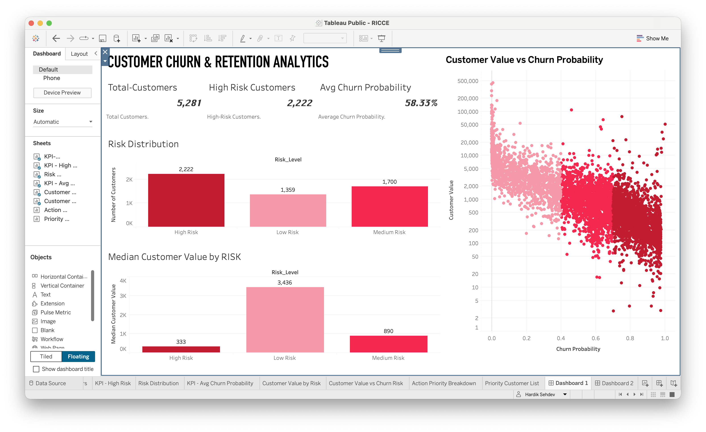
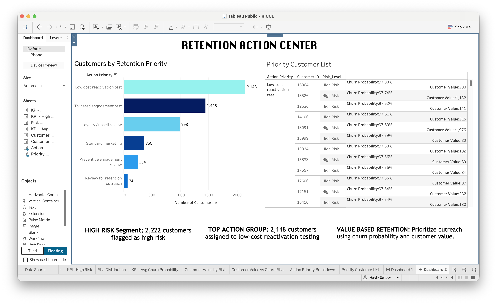

# Customer Churn & Retention Analytics

An end-to-end customer analytics project using **Python, machine learning, and Tableau** to identify customers at risk of churning and support data-informed retention decisions.

[](https://www.python.org/)
[](#project-workflow)
[](https://public.tableau.com/views/RICCE/Dashboard1?:language=en-US&publish=yes&:display_count=n&:origin=viz_share_link)

---

## Project Overview

Customer churn can reduce repeat purchases and long-term customer value. This project develops a customer-level churn prediction workflow and presents the results through interactive Tableau dashboards for customer risk analysis, segmentation, and retention planning.

### Business Questions

- Which customers have the highest predicted churn risk?
- How does customer value differ across churn-risk segments?
- Which at-risk customers may warrant priority retention outreach?
- How can churn probability and customer value inform retention actions?

## Dataset

**Dataset:** Online Retail II  
**Periods:** 2009–2010 and 2010–2011

Historical transaction data is used to study purchasing patterns and derive customer-level behavioral features.

> **Note:** The original dataset should not be redistributed without checking its source and licence. To run the notebook, obtain the dataset from its original source and update the file path to your local copy.

## Tools & Technologies

| Tool | Purpose |
|---|---|
| Python | Data analysis and preprocessing |
| Pandas and NumPy | Data manipulation and feature engineering |
| Scikit-learn | Machine learning and model evaluation |
| XGBoost | Alternative classification model |
| Jupyter Notebook | Analysis and model development |
| Tableau Public | Interactive dashboards and business insights |
| Git and GitHub | Version control and documentation |

## Project Workflow

### 1. Data Preparation

- Inspected transaction records for missing values and inconsistencies.
- Prepared transaction-level data for customer-level analysis.
- Derived customer behavioral features from historical purchasing activity.

### 2. Feature Engineering

Customer-level features include:

- **Recency:** Time since the customer's last purchase.
- **Frequency / Total Orders:** Historical purchasing activity.
- **Monetary Value / Revenue:** Historical spending.
- **Orders 30D / 90D:** Recent purchasing activity.
- **Revenue 30D / 90D:** Recent revenue contribution.
- **Unique Products:** Variety of products purchased.
- **Customer Value:** The value measure used in the analysis.

### 3. Churn Target Definition

Churn is operationally defined as having no purchase during the following **90-day observation window**. This creates a forward-looking target based on future purchasing activity.

The full 90-day observation window must be available for a label to be reliable. Results should be interpreted in the context of the data cutoff and target construction.

### 4. Model Development

The workflow evaluates **Logistic Regression** and **XGBoost** for churn prediction. It includes customer-level model preparation, candidate model comparison, validation-based threshold selection, and generation of churn probabilities and risk segments.

The notebook is the source of truth for the selected model and reported evaluation results. Metrics should be interpreted alongside the target definition, validation design, and business costs of false positives and false negatives.

### 5. Customer Risk Segmentation

Customers are grouped into three risk categories:

- **High Risk:** Prioritize for review and suitable retention outreach.
- **Medium Risk:** Consider targeted engagement.
- **Low Risk:** Continue relationship-building and loyalty initiatives.

Risk categories support prioritization; they do not guarantee that a customer will or will not churn.

## Tableau Dashboards

### 1. Customer Churn & Retention Analytics

The overview dashboard presents:

- Total customers
- High-risk customers
- Average churn probability
- Customer risk distribution
- Median customer value by risk
- Customer value versus churn probability



### 2. Retention Action Center

The retention dashboard connects customer risk analysis to action priorities through:

- Customers by retention priority
- Priority customer list
- Risk levels and churn probabilities
- Customer value
- Retention action categories



### Explore the Interactive Dashboard

**[Open the Tableau Public Dashboard](https://public.tableau.com/views/RICCE/Dashboard1?:language=en-US&publish=yes&:display_count=n&:origin=viz_share_link)**

## Key Insights

- Risk segmentation helps organize customers into groups for different retention approaches.
- Considering customer value alongside predicted churn probability can help surface potentially valuable customers who may need attention.
- Churn probability alone should not determine retention spending; customer value and the likely effectiveness of an intervention also matter.
- Retention action categories provide a practical framework for organizing outreach and engagement efforts.

These are analytical observations and proposed actions, not evidence that a retention campaign has already improved outcomes. Campaign effectiveness should be measured using actual outcomes or controlled experiments.

## Business Recommendations

1. Review high-risk customers with meaningful customer value for personalized retention outreach.
2. Test low-cost reactivation campaigns before committing to more expensive interventions.
3. Use targeted engagement for customers showing signs of declining purchasing activity.
4. Maintain suitable loyalty and relationship-building initiatives for low-risk customers.
5. Track campaign results and refine priorities based on observed customer responses.

## Model Evaluation

The notebook should be used as the source of truth for the selected model and metrics obtained. Relevant evaluation measures include:

- ROC-AUC
- Precision and recall
- F1-score
- Average Precision
- Brier Score, where probability calibration is assessed

Model performance should be considered alongside the business costs of missed churners and unnecessary retention outreach.

## Repository Structure

```text
RICCE/
├── README.md
├── requirements.txt
├── .gitignore
├── Dashboard/
│   ├── dashboard-1-overview.png
│   └── dashboard-2-retention-action-center.png
└── Notebooks/
    ├── Churn_Analysis.ipynb
    └── outputs/
        ├── customer_churn_evaluation_output.csv
        ├── customer_churn_model_metrics.csv
        └── customer_churn_scoring_output.csv
```

This shows the intended project structure. Keep the local virtual environment out of GitHub. Before publishing the original dataset or customer-level CSV outputs, check redistribution permissions and ensure that the files contain no sensitive or inappropriate-to-share information.

## How to Run

### Prerequisites

- Python 3.10 or a compatible version
- Jupyter Notebook or JupyterLab
- The Online Retail II dataset, obtained separately

### 1. Clone the Repository

Replace the URL below with your repository URL.

```bash
git clone https://github.com/hardiksehdev15-lang/customer-churn-retention-analytics.git
cd customer-churn-retention-analytics
```

### 2. Create and Activate a Virtual Environment

```bash
python3 -m venv .venv
source .venv/bin/activate
```

### 3. Install Dependencies

```bash
pip install -r requirements.txt
```

### 4. Configure the Dataset Path

Download the dataset from its original source and update the file path in the notebook to match its location on your computer. Do not commit the original dataset unless its licence permits redistribution.

### 5. Run the Notebook

```bash
jupyter notebook
```

Open `Notebooks/Churn_Analysis.ipynb` and run the cells in order.

## Limitations & Future Improvements

- Evaluate the model with a more extensive time-based backtesting strategy.
- Confirm that every training and evaluation label has a complete future observation window.
- Validate probability calibration and decision thresholds on later data.
- Measure retention campaign effectiveness with controlled experiments.
- Estimate expected incremental retention value rather than relying only on customer value and churn probability.
- Build a repeatable scoring workflow for new customer snapshots.

## Conclusion

This project demonstrates a workflow for transforming historical retail transactions into customer-level churn predictions, risk segments, and retention priorities. By combining Python-based analysis and machine learning with Tableau dashboards, it connects predictive outputs to practical business questions.

---

**Project Focus:** Customer Analytics · Churn Prediction · Machine Learning · Business Intelligence · Tableau
